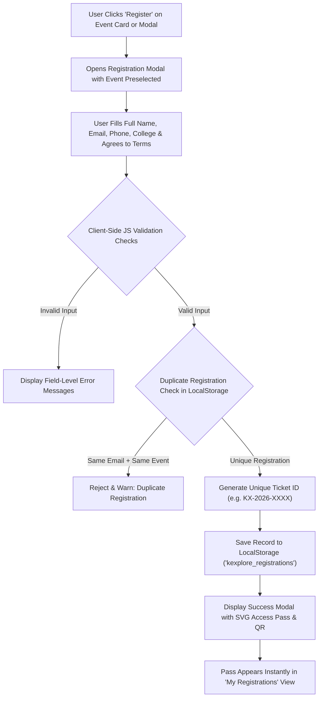

# K EXPLORE — Discover. Experience. Connect.

> **College Web Designing Final Mark Assignment**  
> A premium, responsive event discovery and registration platform built with vanilla web technologies.

---

## 1. Project Title
**K EXPLORE** — Modern Collegiate & Regional Event Management Platform

---

## 2. Project Overview
**K EXPLORE** is an editorial-grade, static event discovery and registration web application designed for students, faculty, tech enthusiasts, and creators. The platform provides a centralized hub where attendees can explore upcoming university conferences, 48-hour competitive hackathons, live music festivals, esports tournaments, angel pitch meets, and hands-on technical workshops.

Built entirely without external heavy frameworks (no React, Next.js, Bootstrap, or Tailwind), K EXPLORE delivers high performance, native browser compatibility, fluid dark/light theming, real-time live countdown timers, and client-side registration persistence through the browser's native **Local Storage API**.

---

## 3. Problem Statement
Across collegiate campuses and regional academic clusters, event discovery is notoriously fragmented:
- **Scattered Information Channels:** Event announcements are routinely buried in social media groups, email newsletters, and physical paper posters, leading to low student engagement.
- **Missed Deadlines & Schedules:** Attendees often lack real-time visibility into registration cut-offs, seating capacity limits, and countdown timers.
- **Fragmented Registration Workflows:** Many organizers rely on external generic survey forms that fail to provide instant booking confirmation, QR-code passes, or the ability for participants to review and cancel their existing reservations.
- **Poor Mobile Experience:** Most academic portal websites are desktop-only with unresponsive tables and broken mobile layouts.

**K EXPLORE** solves this by providing a unified, responsive, high-performance static web experience that bridges attendees and organizers seamlessly.

---

## 4. Key Features

- **Editorial Dark & Light Design System:**
  - Default obsidian dark mode (`#0B0B10`) with vibrant electric violet gradients (`#A78BFA` to `#6D5DFB`).
  - High-contrast, WCAG-accessible light mode (`#F8F9FD`).
  - Smooth theme transitions with preference remembered across visits via Local Storage.
- **Dynamic Event Discovery Engine:**
  - Real-time instant search across event titles, categories, venues, tags, and detailed descriptions.
  - Interactive category filter pills with live item count badges (Technology, Hackathons, Music, Sports, Business, Workshops, Art and Culture).
  - Multi-criteria sorting (Upcoming Soonest, Furthest Date, Alphabetical A–Z, Highest Seat Availability).
  - Designed empty state with a single-click "Reset All Filters" recovery button.
- **Live Event Countdown Timer:**
  - Dynamic second-by-second countdown (Days, Hours, Minutes, Seconds) for every event.
  - Automatically recognizes when an event has commenced or concluded, preventing negative values and disabling registration.
- **Interactive Event Details Modal:**
  - Detailed cover photography with graceful offline SVG fallback handlers.
  - Full event agenda, organizer contact, registration deadline, venue map location, and tag chips.
  - Direct "Register for this Event" bridge that preselects the event in the registration interface.
- **Robust Client-Side Registration System:**
  - JavaScript form validation:
    - Full Name: At least 3 alphabetical characters.
    - Email Address: Standard RFC email format verification.
    - Mobile Number: Valid 10-digit Indian mobile number (`^[6-9]\d{9}$`).
    - Event Selection: Requires open, active upcoming events.
    - Code of Conduct agreement check.
  - **Duplicate Registration Prevention:** Prohibits the same email address from registering multiple times for the identical event.
  - **Unique Pass Generation:** Instantly issues a formatted ticket ID (e.g. `KX-2026-B8F2`) accompanied by an procedural SVG QR access pass.
- **"My Registrations" Self-Service Portal:**
  - Displays all locally saved participant passes from Local Storage.
  - One-click pass printing / digital save view.
  - Cancellation capability with confirmation dialog, updating the stored array in real time.
- **Responsive Layout & Touch Ergonomics:**
  - Responsive grid adapting across mobile devices (320px+), tablets, laptops, and ultra-wide displays.
  - Slide-out mobile navigation drawer with backdrop blur and touch scroll lock.
  - Back-to-top floating button and animated toast notifications.

---

## 5. Technologies Used

| Technology | Role in Project |
| :--- | :--- |
| **HTML5** | Semantic structure, accessibility landmarks (`header`, `nav`, `main`, `section`, `article`, `footer`, `dialog`). |
| **CSS3** | CSS Custom Properties (Design Tokens), Flexbox, CSS Grid, Glassmorphism, animations, responsive `@media` queries. |
| **Vanilla JavaScript (ES6+)** | Dynamic DOM rendering, search/filter algorithms, live countdown intervals, form validation, modal state management. |
| **Browser Local Storage API** | Persistent client-side storage for registrations and theme preferences without requiring an external backend database. |
| **Google Fonts** | `Space Grotesk` (headings & display) and `Inter` (body copy & UI labels). |
| **SVG (Scalable Vector Graphics)** | Crisp iconography, brand wordmark, offline fallback illustrations, and procedural ticket QR codes. |
| **Git** | Distributed version control with clean commit history. |

---

## 6. Project Folder Structure

```
K-Explore/
│
├── index.html                  # Main application markup & modal templates
├── css/
│   └── style.css               # Design tokens, themes, layouts, and responsive styles
├── js/
│   ├── data.js                 # Centralized multi-category sample event catalog
│   └── script.js               # Application logic, filters, modals, countdown & LocalStorage
├── assets/
│   ├── icons/
│   │   └── favicon.svg         # SVG brand favicon
│   └── images/
│       └── placeholder.svg     # Offline SVG fallback image
├── .gitignore                  # Git ignore rules for OS and IDE files
└── README.md                   # Complete project documentation
```

---

## 7. Instructions to Run Locally

Because **K EXPLORE** is built entirely with client-side vanilla web standards, you can run it using any of the following methods without installing heavy Node modules or packages:

### Method A: Directly via Browser
1. Clone or download the repository to your local computer.
2. Double-click `index.html` or right-click `index.html` and select **Open with Google Chrome / Microsoft Edge / Mozilla Firefox / Safari**.

### Method B: Using Python's Built-in HTTP Server (Recommended)
If you have Python installed:
```bash
# Navigate to the project root directory
cd path/to/K-Explore

# Start a local static server (Python 3)
python -m http.server 8000
```
Then open your web browser and navigate to:
```
http://localhost:8000
```

### Method C: VS Code Live Server
1. Open the project folder in **Visual Studio Code**.
2. Install the **Live Server** extension (by Ritwick Dey).
3. Right-click on `index.html` and click **"Open with Live Server"**.

---

## 8. Explanation of Local Storage Implementation

The platform leverages the native browser `window.localStorage` API to ensure that user data and preferences persist across page refreshes and browser sessions without a dedicated backend server.

### Key Data Stores:
1. **`kexplore_theme`**:
   - Stores `'dark'` or `'light'`.
   - On page load, `initTheme()` checks this key. If absent, it queries `window.matchMedia('(prefers-color-scheme: dark)')` and defaults to `'dark'`.
2. **`kexplore_registrations`**:
   - Stores a JSON serialized array of registration objects:
   ```json
   [
     {
       "ticketId": "KX-2026-F9A2B",
       "eventId": "ev-hack-02",
       "eventTitle": "HackKrypton 48-Hour National Hackathon",
       "eventCategory": "Hackathons",
       "eventDate": "Sat, Nov 14, 2026",
       "eventTime": "10:00 AM",
       "eventVenue": "Innovation & Incubation Hub, Wing B",
       "fullName": "Rahul Verma",
       "email": "rahul.verma@example.com",
       "phone": "9876543210",
       "organization": "School of Computer Engineering",
       "registeredAt": "2026-11-07T14:30:00.000Z",
       "status": "Confirmed"
     }
   ]
   ```

### Safe Serialization & Error Handling:
All Local Storage operations are wrapped in `try ... catch` blocks to gracefully handle environments where storage might be disabled, in private browsing mode, or storage quotas are exceeded.

---

## 9. Description of Event Search and Filtering

The event discovery interface (`#explore`) provides dynamic, multi-faceted filtering in real time:

1. **Category Filtering (`categoryPillList`):**
   - Clicking any pill filters the list to events matching that category (`All`, `Technology`, `Hackathons`, `Music`, `Sports`, `Business`, `Workshops`, `Art and Culture`).
   - Active pills display dynamically counted event numbers.
2. **Full-Text Live Search (`searchInput`):**
   - Filters events on keystroke across:
     - Event Title
     - Category name
     - Venue & Location
     - Short & Detailed Descriptions
     - Event Organizer & Tags
   - Includes a clear (`✕`) button to quickly reset search terms.
3. **Sorting Mechanism (`sortSelect`):**
   - **Upcoming First (Default):** Chronological order based on `Date.parse(isoDate)`.
   - **Furthest Date:** Reverse chronological order.
   - **Alphabetical (A-Z):** Ascending order by `event.title`.
   - **Most Seats Available:** Sorted by `event.seatsLeft`.
4. **Empty State & Reset Filter:**
   - If no events match the active combination of search keywords and category, a friendly illustrated empty state is rendered with a `"Reset All Filters"` button that restores the default view.

---

## 10. Registration and Validation Workflow



### Validation Rules:
- **Full Name:** Minimum 3 characters; alphabetic letters and spaces only (`/^[a-zA-Z\s]{3,50}$/`).
- **Email Address:** Complies with RFC standard regex (`/^[a-zA-Z0-9._%+-]+@[a-zA-Z0-9.-]+\.[a-zA-Z]{2,}$/`).
- **Mobile Number:** Valid Indian 10-digit mobile number starting with 6, 7, 8, or 9 (`/^[6-9]\d{9}$/`).
- **Event Status:** Prevents registration for past or closed events.
- **Duplicate Prevention:** Iterates through existing records; if a record exists matching both `event.id` and `user.email.toLowerCase()`, registration is rejected with an informative error.

---

## 11. Screenshots Section

| Screen View | Description | Placeholder Preview |
| :--- | :--- | :--- |
| **Desktop Homepage Hero** | Obsidian dark mode hero with spotlight card, quick search, and live metrics. | *`[Screenshot Placeholder: Hero Section]`* |
| **Explore Events & Filters** | Dynamic grid with category filter pills, sort dropdown, and search input. | *`[Screenshot Placeholder: Explore Grid]`* |
| **Event Details Modal** | High-res cover image, dynamic live countdown timer, and agenda specs. | *`[Screenshot Placeholder: Event Details Modal]`* |
| **Registration & Pass** | Validated registration form with generated digital access pass & QR code. | *`[Screenshot Placeholder: Registration Ticket]`* |
| **My Registrations View** | Card list of saved reservations with pass printing and cancellation actions. | *`[Screenshot Placeholder: My Registrations View]`* |
| **Light Theme Mode** | Crisp, high-contrast light theme variation. | *`[Screenshot Placeholder: Light Theme View]`* |

---

## 12. Deployment Instructions

Since K EXPLORE is a static client-side web application, it can be deployed for free in under two minutes through any of the following platforms:

### Option 1: GitHub Pages
1. Push your repository to GitHub:
   ```bash
   git init
   git add .
   git commit -m "feat: complete K Explore event management platform"
   git remote add origin https://github.com/<your-username>/<your-repo-name>.git
   git branch -M main
   git push -u origin main
   ```
2. In your GitHub repository, navigate to **Settings** > **Pages**.
3. Under **Build and deployment** > **Branch**, select `main` and `/ (root)`.
4. Click **Save**. Within 1–2 minutes, your site will be live at `https://<your-username>.github.io/<your-repo-name>/`.

### Option 2: Netlify
1. Go to [Netlify.com](https://www.netlify.com/) and log in.
2. Drag and drop the `K-Explore` folder directly into the Netlify dashboard.
3. Netlify will instantly provide a live production URL.

### Option 3: Vercel
1. Install Vercel CLI via `npm i -g vercel` or import the GitHub repository on [Vercel.com](https://vercel.com).
2. Accept the default static settings and click **Deploy**.

---

## 13. Future Improvements
While K EXPLORE fully meets and exceeds all requirements for the Web Designing evaluation, potential future enhancements could include:
- Integration with payment gateway sandboxes (e.g. Razorpay or Stripe) for paid ticket tiers.
- PDF pass generation using native Canvas / jsPDF.
- Calendar integration (Apple iCal / Google Calendar `.ics` file downloads).
- Multi-language localization support (i18n).
- Organizer dashboard for direct browser-based event creation and CSV participant export.

---

## 14. Author & Attribution

- **Project Name:** K EXPLORE Event Management Platform
- **Course / Assignment:** College Web Designing Final Mark Evaluation
- **Lead Developer:** `[Student / Developer Name]`
- **Roll Number / Student ID:** `[Student ID Placeholder]`
- **Department:** Department of Computer Science & Engineering
- **Institution:** `[University / College Name]`
- **Academic Year:** 2025–2026
- **License:** Open-source MIT License for educational purposes.
